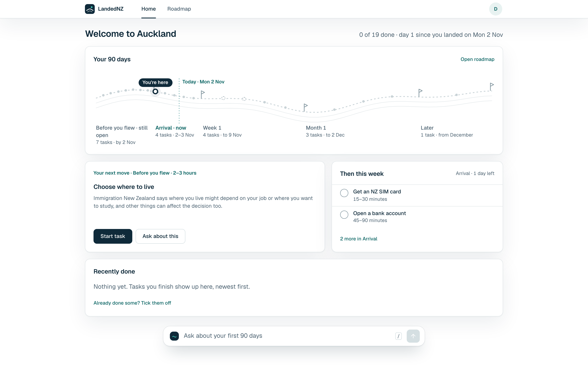
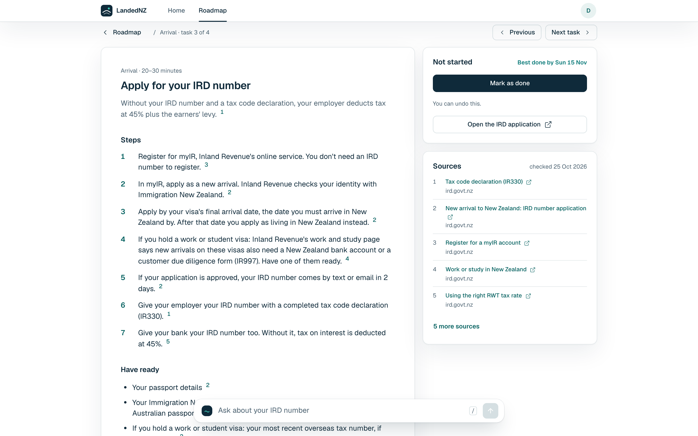
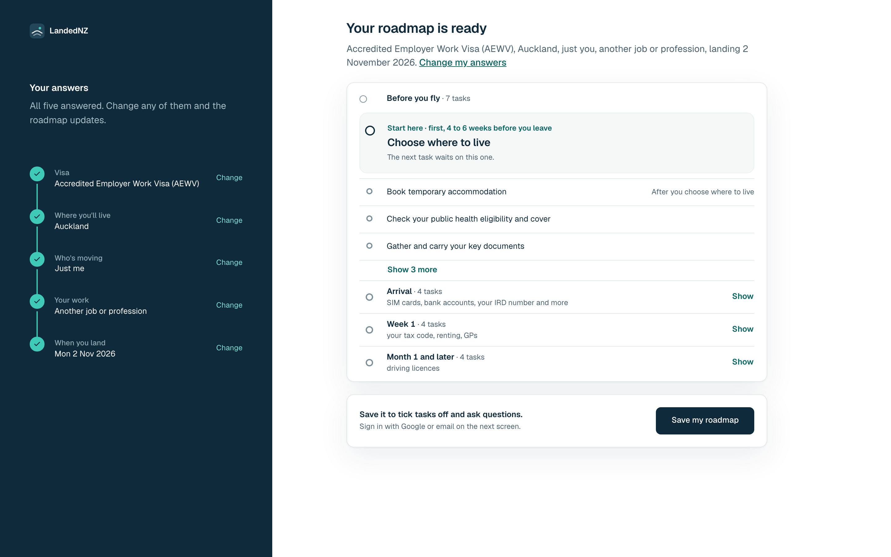
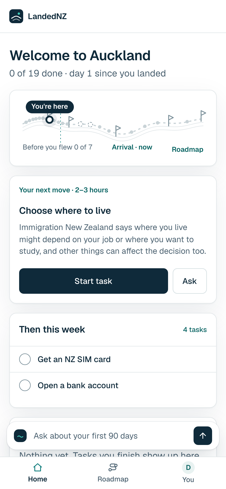

# LandedNZ

[](https://github.com/LordMaduz/landednz/actions/workflows/ci.yml)

[LandedNZ](https://landednz.co.nz) is a personalised settlement roadmap and a cited question-and-answer guide for skilled migrants in their first 90 days in New Zealand.

- **A roadmap built from five answers.** Visa, city, household, work and arrival date decide which tasks and wording a person sees.
- **Every claim has a source.** Each step names its official source and the date it was last checked; the content build fails without both.
- **A guide that shows its sources.** It answers from LandedNZ's checked content first, then from a fixed list of official New Zealand sites, and labels which. It is read-only and never acts for the person.
- **Public guide pages** generated from the same content as the app.

## Screenshots

| Home | Task with sources |
|---|---|
|  |  |

| Roadmap preview before sign-in | Phone |
|---|---|
|  |  |

Captured from a production build of this repository with mock AI mode and a throwaway account; see [design-system.md](docs/design-system.md#screens) for viewports.

## Documentation

| | |
|---|---|
| [Product](docs/product.md) | Who it serves, what it does, the trust model, what is deliberately not built |
| [Architecture](docs/architecture.md) | System context, building blocks, the guide pipeline, content verification, data model, decisions, risks |
| [Design system](docs/design-system.md) | Tokens, type, spacing, components and how they are enforced |
| [Deployment](docs/deployment.md) | Topology, environments, release flow, rollback |
| [CLAUDE.md](CLAUDE.md), [constitution](.claude/constitution.md) | Rules for engineers and coding agents |

## Built with

TypeScript monorepo on Node 24 (npm workspaces).

- **API:** Fastify, Prisma on PostgreSQL with pgvector, the Anthropic and OpenAI SDKs, Vitest
- **Web:** Next.js App Router, React, Tailwind CSS, shadcn/ui, Vitest, Playwright
- **Platform:** Supabase (auth and database), Vercel, Railway, Sentry, PostHog

Exact versions are in the `package.json` files.

## Getting started

Prerequisites: Node 24 (see `.nvmrc`), Docker running, the [Supabase CLI](https://supabase.com/docs/guides/local-development/cli/getting-started) and `make`. No API keys are needed: with `AI_MODE=mock`, the default in the example environment, the guide returns deterministic replies and embeddings.

```sh
make setup   # install, generate the Prisma client, install the e2e browser, create .env.local files
make dev     # Supabase, database seed if empty, API on :3001, web on :3000
```

`make dev` takes about 30 seconds with Docker warm. Check <http://localhost:3001/health> (`"dbConnected":true`) and <http://localhost:3000>. Sign-in uses Google; for a local password sign-in create a user and open <http://localhost:3000/signin>:

```sh
make user EMAIL=you@example.com PASSWORD=choose-a-password
```

For Google sign-in locally, put the OAuth client secret in `supabase/.env` (see `supabase/.env.example`). For real model replies set `AI_MODE=live`, `ANTHROPIC_API_KEY` and `OPENAI_API_KEY` in `apps/api/.env.local`.

## Development

Run `make` to list every target.

| Command | What it does |
|---|---|
| `make check` | Content validation, typecheck, lint, unit tests and builds: what CI runs before e2e |
| `make test` | API and web unit tests (Supabase must be running) |
| `make test-e2e` | Playwright journeys; starts the API and web if they are not up |
| `make content` | Validate the content and write the bundle |
| `make db-reset` | Wipe the local database and seed it again |
| `make docker-api` | The production API container on :3001 against local Supabase |
| `make stop` | Stop local services (data is kept) |

## Repository

| Path | What |
|---|---|
| `apps/api` | Fastify API and the verified content (`content/`) |
| `apps/web` | Next.js web app |
| `packages/types` | Contract types shared by both |
| `supabase/` | Local Supabase stack configuration |
| `docs/` | Product, architecture, design system and deployment documentation |
| `.github/workflows` | CI, staging checks and a scheduled health check |

## License and trademarks

Copyright (c) 2026 Ruchira Madhushan Rajapaksha. All rights reserved. The source is published for reading only; no licence is granted to use, copy, modify or distribute it. See [LICENSE](LICENSE). The LandedNZ name and logo are not licensed for use.
