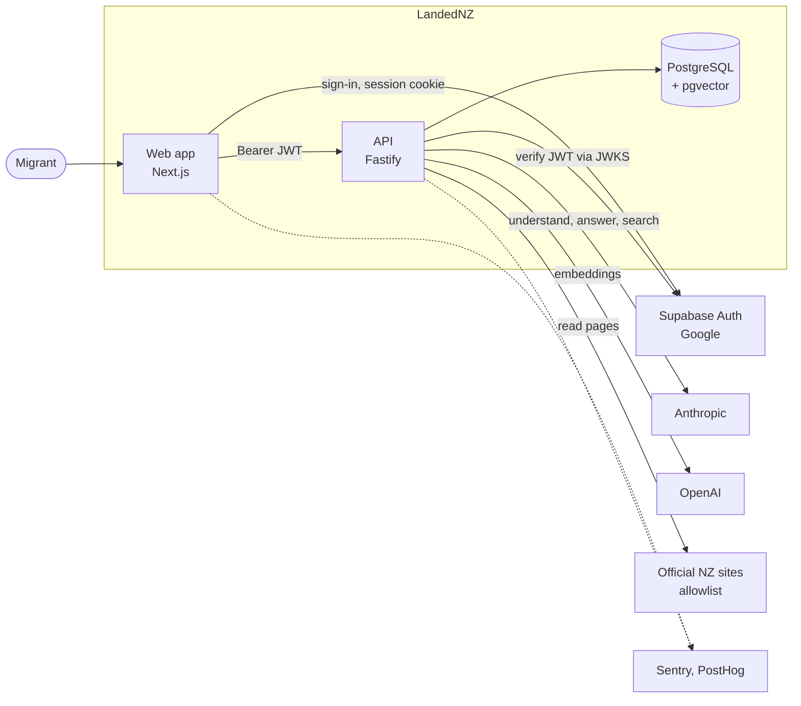

# Architecture

Structured after the [arc42](https://arc42.org) template (sections 1 to 12; empty ones omitted) with a [C4](https://c4model.com) container diagram. Facts here are taken from the code at the paths given; when they disagree with this page, the code is right.

## 1. Introduction and goals

LandedNZ gives a newly arrived migrant a personalised, sourced settlement roadmap and a guide that answers questions from checked sources. What the product does is in [product.md](product.md). The goals that shape the design:

| Goal | How the design serves it |
|---|---|
| Every claim is traceable to an official source | Content items carry a source and a checked date; the build fails without them (§8.1). The guide answers only from retrieved passages and verifies its citations (§6) |
| The AI cannot take consequential actions | The guide is read-only. Roadmap ordering is deterministic code with no model in it (§8.2) |
| Bounded cost and failure | Per-person daily question cap, whole-turn time limit, per-IP rate limit, AI failures contained inside the guide (§8.3) |
| Usable by everyone, mostly on phones | Role-based design tokens, WCAG checks in CI, reduced motion respected ([design-system.md](design-system.md)) |

## 2. Constraints

- TypeScript monorepo (npm workspaces), Node 24 (`.nvmrc`).
- Authentication is Supabase; the API never stores credentials. Supabase JWTs are ES256, verified through the JWKS endpoint with `jose`; there is no shared secret.
- Persistence is PostgreSQL with pgvector. Schema changes go through Prisma migrations only.
- Content may not ship unverified (`CONTENT_ALLOW_UNVERIFIED` exists for local development only).
- Light theme only; English only.

Rules that engineers and coding agents must follow are listed in [`.claude/constitution.md`](../.claude/constitution.md) and [`CLAUDE.md`](../CLAUDE.md).

## 3. Context and scope

| External system | Used for | Boundary |
|---|---|---|
| Supabase Auth | Google sign-in, sessions, user admin API for account deletion | Hosts the database too |
| Anthropic | Query understanding, cited answers, finding official pages | Only through `apps/api/src/shared/ai/claude.client.ts` |
| OpenAI | `text-embedding-3-small` (1536 dimensions) for retrieval | Only through `shared/ai/embeddings.client.ts` |
| Official NZ sites | Live answers when checked content has no match | Hosts in `features/guide/allowlist.ts` only; text is cached |
| Sentry, PostHog | Errors and product analytics | Each off while its key is empty |

## 4. Solution strategy

- **Content is data, not code.** Task content lives in YAML under `apps/api/content/`, validated by a build step and served as a versioned bundle. The same bundle feeds the roadmap, the guide's retrieval chunks and the public guide pages, so they cannot disagree.
- **Deterministic core, AI at the edge.** Scoring and dependency resolution are pure functions. Models are used only inside the guide.
- **Typed contracts.** `packages/types` holds the request and response shapes and the onboarding dimensions (generated from `dimensions.yaml`); web and API import the same types.
- **Stream finished sentences.** The guide streams over server-sent events through a gate that releases only complete, citation-checked sentences.

## 5. Building block view

| Block | Path | Responsibility |
|---|---|---|
| API server | `apps/api/src/server.ts` | Config check, content load, CORS, rate limit, error handler, routes, graceful shutdown |
| `features/health` | | `GET /health` (database reachability, never rate-limited), `GET /config` (reports `betaMode`) |
| `features/auth` | | `POST /auth/verify`: find or create the local user for a verified token |
| `features/onboarding` | | `POST /onboarding/preview`, `POST` / `PATCH` / `GET /onboarding/profile` |
| `features/roadmap` | | `GET /roadmap`, task detail, complete, reopen, `POST /roadmap/bulk-override`, `POST /admin/recalculate` |
| `features/guide` | | `POST /guide/messages` (SSE), cancel, retry, `GET /guide/conversation`, `/guide/opening`, `/guide/memories`; sweeper |
| `features/account` | | `DELETE /account` removes the person's data and their Supabase user |
| `core/` | `apps/api/src/core` | Pure functions: priority scoring, dependency resolution, prompt registry |
| `content/` | `apps/api/src/content` | Schema, rules, build, chunking, bundle loader |
| Web app | `apps/web/src/app` | Routes in [product.md](product.md#screens); `proxy.ts` guards `/app` and `/settings` |
| Shared types | `packages/types` | Contract types and dimensions |

Data model, from `apps/api/prisma/schema.prisma`:

| Model | Holds |
|---|---|
| `User`, `UserProfile` | Account and onboarding answers (visa, city, family, occupation, arrival date) |
| `UserRoadmapEntry` | One row per user and task: status, priority score, blocked flag, content version |
| `KnowledgeBaseChunk` | Retrieval passages derived from the bundle: text, source URL and name, 1536-d embedding, generated `tsvector` |
| `ContentRelease` | Each bundle version the API has served |
| `GuideConversation`, `GuideMessage`, `GuideMemory` | One conversation per user; messages with typed reply parts and per-answer metadata; facts the person chose to keep |
| `LiveSourceCache` | Text of official pages the guide has read |
| `Subscription` | Unused leftover from an earlier payments design (§11) |

Deleting a user cascades to every table above except `ContentRelease` and `LiveSourceCache`, which hold no personal data.

## 6. Runtime view: one guide turn

`apps/api/src/features/guide/service.ts`:

1. A keyword check for a crisis signal sends fixed crisis text before any model call.
2. In parallel, **understand** (a small model extracts the search query, scope, distress and facts to remember) and **retrieve** (SQL pre-filter on the person's answers, then vector and keyword search fused by reciprocal rank, `retrieve.ts`).
3. If retrieval finds nothing or the question needs fresh data, **live**: the model proposes pages, and only allowlisted official hosts are fetched (`live.ts`, 24 h cache, 7 day stale fallback).
4. **Answer** with citations. The **sentence gate** (`sentences.ts`) releases only finished sentences and replaces internal task and chunk IDs with real titles. Text already shown is never taken back.
5. **Verify** (`verify.ts`): each citation must quote a passage that was sent; factual sentences with no citation add an "unverified" note.
6. **Remember**: save facts the person stated, best-effort, at most 50.
7. **Finish**: persist parts, latency per step, tokens and cost.

Limits: 20 questions per person per New Zealand day (`GUIDE_DAILY_CAP`), 100 s per turn, one streaming answer per person. A sweeper marks abandoned streams `interrupted` and expires cached pages after 30 days. The browser reads the stream with `fetch` and `ReadableStream` (an `EventSource` cannot send `Authorization`) and renders typed parts; it never parses reply text.

## 7. Deployment view

Web on Vercel, API in a Docker container on Railway, Supabase for database and auth, a Render service for staging. Details and what is verified: [deployment.md](deployment.md).

## 8. Crosscutting concepts

### 8.1 Content and verification

Files in `apps/api/content/`: `tasks/T*.yaml` (steps, documents, mistakes, watch-outs, cost; each item has an `id`, text, `source`, `checked` date and `verified` flag, with optional conditions on the person's answers), `sources.yaml` (URL, agency, tier), `facts/*.yaml` (reusable values referenced as `{{fact.id}}`), `dimensions.yaml` (allowed onboarding answers).

`npm run content:build` runs the rules in `src/content/rules.ts` and writes the bundle. Rules include: every item cites a known source; government sources sit on a government or Crown-entity domain; text containing a dollar amount, percentage, duration or date must come from a fact; staleness is measured against the source tier; first-person or invented-persona wording is rejected. Unverified items fail the build unless `CONTENT_ALLOW_UNVERIFIED=true`. `npm run content:review` renders every visible variant of a task for human approval before it is marked verified. After a content deploy, `POST /admin/recalculate` reconciles existing roadmaps.

### 8.2 Roadmap ordering

`features/roadmap` selects the tasks that apply to the person's answers and scores them with `core/priority/scoring.ts`: base priority, plus boosts for matching answers, plus time urgency after arrival, minus a penalty while a hard prerequisite is open (`core/dependencies/resolver.ts`). Completing or reopening a task recomputes only its dependents.

### 8.3 Errors, limits and abuse

Expected failures are `AppError` with a typed `ErrorCode`. A provider failure is an `AIFailureError`, caught inside the guide so the roadmap never fails because of it. A global per-IP rate limit (`RATE_LIMIT_PER_MINUTE`) sits before the routes; `TRUST_PROXY` makes it see the client address behind the platform proxy.

### 8.4 Testing

| Layer | Tool | Notes |
|---|---|---|
| API | Vitest | Integration tests use real local Supabase users; auth is not mocked |
| Web unit | Vitest, Testing Library | Includes guards: `cw01.test.ts` (design roles only), type and size role tests |
| End to end | Playwright | Sign-in, onboarding, guide, axe accessibility, layout at 390 and 1440 px |
| Performance | Lighthouse CI | Landing, onboarding, sign-in |

`AI_MODE=mock` replaces every model and embedding call with deterministic output (`shared/ai/mock.ts`), which is what tests and CI use. CI (`.github/workflows/ci.yml`) starts a Supabase stack in the job, then runs typecheck, lint, tests, builds, Lighthouse, a Docker build of the API and the Playwright suite.

### 8.5 Observability

Sentry (API and web), PostHog (web), Pino logs, and a daily check that logs when the average answer cost passes its budget (`features/guide/sweeper.ts`). Every guide answer stores latency, tokens and cost in `GuideMessage.meta`.

## 9. Architectural decisions

| Decision | Reason | Consequence |
|---|---|---|
| Verified answers over an autonomous agent | The product's value is that claims can be checked; an agent that acts adds risk before trust is established | The guide explains and links; the person acts |
| Content as validated YAML, not a CMS | Review in pull requests; the build can enforce sourcing rules | Editing content needs a code change and a deploy |
| No model in roadmap ordering | Order must be explainable and testable | New ordering rules are code in `core/` |
| Hybrid retrieval with an SQL persona pre-filter | Filtering after vector search can drop relevant, applicable passages | Retrieval takes the person's answers as input |
| Sentence gate over token streaming | A half sentence or an internal ID must never reach the screen | Slightly later first text |
| Supabase Auth instead of own accounts | No credentials to store or secure | Local development needs the Supabase CLI stack |

## 10. Quality

Accessibility is checked in CI with axe and by keyboard and reduced-motion rules in the web constitution. Performance is checked with Lighthouse CI on three pages. Answer accuracy is measured offline with `npm run guide:accuracy -w @landednz/api` against live models; it is not part of CI.

## 11. Risks and technical debt

- The in-flight answer map in `features/guide/service.ts` is in memory, so cancel and retry assume one API instance. Move it to a database flag before scaling out (marked `shortcut:` in the code).
- `Subscription` and `BETA_MODE` are leftovers from a payments design that is not built; remove them or revive them deliberately.
- Some official sites block automated reads (`GUIDE_ONLY_HOSTS`); their checked content still answers, but live lookups do not.
- Design-token coverage for spacing is partial; see [design-system.md](design-system.md#known-gaps).

## 12. Glossary

| Term | Meaning |
|---|---|
| Dimension | One of the four onboarding answers that drive content (visa, city, family, occupation) |
| Bundle | The validated, versioned output of `content:build` |
| Chunk | A retrieval passage derived from the bundle |
| Leg | One of five roadmap groups: Before you flew, Arrival, Week 1, Month 1, Later |
| Sentence gate | The stage that releases only finished, checked sentences to the client |
